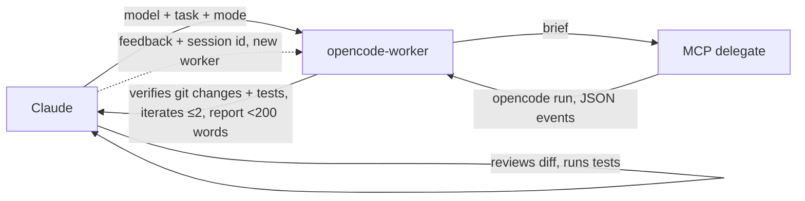

# claude-opencode-delegate

A Claude Code plugin that delegates scoped tasks to any model available in your [OpenCode](https://opencode.ai) install (Grok, Kimi, GLM, Qwen, DeepSeek, MiMo, MiniMax, …). Claude stays the orchestrator: it hands over the task, then reviews the diff and runs the tests.

```text
you    ▸ /opencode grok 4.7 -- add input validation to the signup form
claude ▸ spawns opencode-worker (model: grok 4.7, mode: write)
worker ▸ MCP delegate → session ses_abc, 3 files changed, report
claude ▸ reads git diff, runs tests, reports which model did what and a verdict
```

## What ships

| Surface | File                                        | Role                                                                                                       |
| ------- | ------------------------------------------- | ---------------------------------------------------------------------------------------------------------- |
| Skill   | `skills/opencode-delegate/SKILL.md`         | Model picking, brief template, review-after-return rules                                                   |
| Agent   | `agents/opencode-worker.md`                 | Supervisor (`model: haiku`, `background: true`, all tools): calls MCP `delegate`, verifies, iterates       |
| Command | `commands/opencode.md`                      | `/opencode <model> -- <task>`: splits on `--`, spawns `opencode-worker`                                    |
| Hook    | `scripts/route-to-opencode.sh`              | PreToolUse hook (`plugin-hooks/hooks.json`): reroutes built-in subagent calls to `opencode-worker`         |
| Hook    | `scripts/guard-main-thread-mcp.sh`          | PreToolUse hook (`plugin-hooks/hooks.json`): denies `delegate`/`delegate_async` calls from the main thread |
| MCP     | `plugin.json` `mcpServers`, `dist/index.js` | `opencode` MCP server (bundled from `src/index.ts`): `delegate` and friends, called by `opencode-worker`   |

The MCP server exposes seven tools: `delegate` (run and wait), `delegate_async` (background run, returns a task id), `task_result`, `task_list`, `task_cancel`, `list_models` and `list_sessions`. Only `opencode-worker` calls them: the main thread spawns the worker in the background, because `delegate` blocks the main thread and `delegate_async` tasks are lost when `/reload-plugins` restarts the server. A PreToolUse hook denies `delegate` and `delegate_async` calls made without an `agent_id` (the main thread). `dist/index.js` is a committed bundle (the installed plugin cache has no `node_modules`); rebuild it with `bun run build` after changing `src/`, CI fails if it is stale. Claude Desktop is not supported.

## How it works



The worker resolves the model and mode (read-only tasks pass `auto: false`), gathers context, writes a self-contained brief and calls the MCP `delegate` tool. It then reads the git changes, runs the tests or build, iterates at most twice with the same `session_id`, and reports the model, session id, changed files, verification and a verdict in under 200 words. The main thread never calls `delegate` itself; to fix something after the report, spawn a worker again with the session id.

The MCP server runs this command:

```bash
opencode run --format json --agent build --auto [-m provider/model[#variant]] [--session <id>] --title "<title>" -- "<prompt>" </dev/null
```

The run uses your existing OpenCode auth, config, agents and permission rules.

## Automatic routing

The MCP server sends `instructions` that clients inject into every session's system prompt, even when the tools are deferred; they make delegation the default for self-contained implementation and broad read-only exploration, and define delegating as spawning `opencode-worker` subagents in the background (one per independent task, parallel when files do not overlap) so the main thread is never blocked; the `delegate`, `delegate_async` and `task_*` tools belong to the worker and the main thread never calls them; Claude keeps planning, one-line edits, git and delivery, and anything the user asked it to do itself; the text lives in `INSTRUCTIONS` in `src/index.ts`.

A plugin PreToolUse hook (`scripts/route-to-opencode.sh`, wired by `plugin-hooks/hooks.json`) rewrites `Agent`/`Task` calls to Claude Code's built-in subagents into a call to `opencode-delegate:opencode-worker` on Haiku. The `description` and any other input keys are kept; the worker runs the task through MCP `delegate` using OpenCode's configured default model. The prompt is kept as is for `general-purpose` and untyped calls. `Explore`, `Plan` and `claude-code-guide` calls get a `Read-only task (routed from the ... subagent).` prefix, which forces the worker into read-only mode. `statusline-setup` gets a `Routed from the ... subagent.` note; `claude` is kept as is. Only these built-ins are routed: custom, project, user and plugin agents (reviewers and SDD agents included, and `opencode-worker` itself) are never routed and stay on Claude.

The hook never blocks. It passes the call through unchanged when:

- The subagent is not a built-in one (custom, project, user or plugin agent, including reviewers and SDD agents).
- `OPENCODE_DELEGATE_ROUTE` is `0`, `false`, `no` or `off` (global opt-out; unset or empty means routing is on).
- `OPENCODE_BIN` (default `opencode`) cannot be found, so Claude keeps the original subagent.
- The prompt contains the literal `[no-opencode]` (per-task opt-out).
- `jq` is missing, or the hook input is not valid JSON.

A second PreToolUse hook (`scripts/guard-main-thread-mcp.sh`) denies `delegate` and `delegate_async` calls (tool names `mcp__plugin_opencode-delegate_opencode__*` and `mcp__opencode__*`) made from the main thread, with a reason telling Claude to spawn `opencode-delegate:opencode-worker` in the background. Claude Code puts `agent_id` in the hook input only inside a subagent, so calls from the worker pass through. It passes through as well when `OPENCODE_DELEGATE_ROUTE` is falsy, `jq` is missing, or the input is not valid JSON.

Because the hooks are shipped in `plugin-hooks/`, not `hooks/` (which holds this repo's git hooks), they take effect after the plugin is installed or refreshed.

## Requirements

- [OpenCode](https://opencode.ai) v2+ with at least one provider configured (`opencode models` lists something). Behaviour documented here was verified on 2.1.2.
- `jq` on `PATH` (the hooks parse JSON with it).
- `git` (changed-file detection).

## Install

```text
/plugin marketplace add lehcode/claude-opencode-delegate
/plugin install opencode-delegate@claude-opencode-delegate
```

To use a local clone, add it as a directory marketplace: `/plugin marketplace add /path/to/clone`. After pulling changes, refresh the plugin (`/plugin` → update, or reinstall).

### As a standalone MCP server (npm)

The MCP server is also published to npm as `@lehcode/claude-opencode-delegate` (needs [Bun](https://bun.sh)). Register it in any MCP client with command `bunx` and args `["@lehcode/claude-opencode-delegate"]`; see `examples/claude_desktop_config.json`.

## Usage

Three entry points, all ending in the same `opencode-worker`:

- **Natural language:** "Use kimi k3 via opencode to add tests for `src/date.ts`."
- **Slash command:** `/opencode deepseek v4 flash -- write unit tests for src/date.ts`
- **Agent:** spawn `opencode-worker` from a subagent or workflow with the model and task in its prompt.

### Modes

| Mode            | When                                      | OpenCode flags               |
| --------------- | ----------------------------------------- | ---------------------------- |
| write (default) | Implement, fix, refactor                  | `--agent build --auto`       |
| read-only       | Review, question, summary, second opinion | `--agent plan` (no `--auto`) |

- Write mode passes `--agent build` because OpenCode's `default_agent` is commonly `plan`.
- `--auto` approves permissions not explicitly denied; rules set to `deny` are still enforced.
- Without `--auto`, a headless run auto-rejects permission requests and continues, which is what makes `plan` safe for read-only work.
- `</dev/null` is mandatory: with an open stdin pipe, `opencode run` waits forever and never creates a session.

### Models

| Input                    | Behaviour                                                                                                        |
| ------------------------ | ---------------------------------------------------------------------------------------------------------------- |
| none                     | `-m` omitted; OpenCode uses its configured default model (e.g. `"model"` in `~/.config/opencode/opencode.jsonc`) |
| exact `provider/model`   | Used as is                                                                                                       |
| loose name (`grok 4.7`)  | Resolved against `opencode models`; a named version must match exactly (4.7 never becomes 4.6)                   |
| ambiguous loose name     | Candidate list returned to Claude instead of a guess                                                             |
| `provider/model#variant` | Variant preserved, e.g. `xai/grok-4.7#high`                                                                      |

There are no built-in default models.

### Continuing a session

The worker reports a session id. To give feedback, or to continue after a timeout, invoke `opencode-worker` again with that session id and precise feedback. A run is expected to finish within about 10 minutes (Bash tool timeout maximum is 600000 ms).

### Parallel work

Spawn one `opencode-worker` per model or subtask. Writers share the working directory, so parallel edits need separate git worktrees (`git worktree add`) or non-overlapping files. To compare models, give the same task to each in its own worktree, then diff the results.

## Configuration

| Variable                  | Default    | Description                                                                                                    |
| ------------------------- | ---------- | -------------------------------------------------------------------------------------------------------------- |
| `OPENCODE_BIN`            | `opencode` | Path to the `opencode` executable used by the routing hook and the MCP server                                  |
| `OPENCODE_DELEGATE_ROUTE` | on         | Set to `0`, `false`, `no` or `off` to disable automatic routing and the main-thread guard (read by both hooks) |

These are the only variables the plugin honors.

## Development

```bash
bun install
bun run verify                     # typecheck + test + lint + format
bun test test/models.test.ts       # one file
bun test -t "<name>"               # filter by test name
git config core.hooksPath hooks/   # pre-commit (staged lint/format), pre-push (verify)
```

`.prettierignore` excludes local `.atl/`, `openspec/` and `odd/`. Tests are fixture-based and need no running services.

### MCP server and library (`src/`)

`src/index.ts` is the MCP server entry point (`bun run start`, bundled to `dist/index.js` by `bun run build`); it builds on the `delegate`, `resolveModel`, `buildArgs` and `EventCollector` modules, which also document how `opencode run` is invoked and its JSON stream parsed. Changing `src/` changes the MCP tools, so rebuild and commit `dist/`. The provider preference (direct provider over an aggregator, `OPENCODE_DELEGATE_PREFERRED_PROVIDERS` first) applies to model resolution inside the MCP server, so it also covers the worker. Variables read by `src/config.ts`:

| Variable                                | Default       | Description                                                                                             |
| --------------------------------------- | ------------- | ------------------------------------------------------------------------------------------------------- |
| `OPENCODE_BIN`                          | auto-detected | Path to `opencode`                                                                                      |
| `OPENCODE_DELEGATE_DEFAULT_MODEL`       | unset         | Model when none given, for write and read-only runs; unset or empty means OpenCode's configured default |
| `OPENCODE_DELEGATE_AUTO`                | `true`        | Default for `auto`; `0`, `false`, `no`, `off` disable it                                                |
| `OPENCODE_DELEGATE_TIMEOUT`             | `1800`        | Seconds before a run is killed                                                                          |
| `OPENCODE_DELEGATE_MAX_OUTPUT`          | `40000`       | Maximum response characters returned                                                                    |
| `OPENCODE_DELEGATE_THINKING`            | `true`        | Include reasoning blocks in output                                                                      |
| `OPENCODE_DELEGATE_CWD`                 | process cwd   | Base working directory                                                                                  |
| `OPENCODE_DELEGATE_PREFERRED_PROVIDERS` | none          | Comma-separated provider order when a model has several providers                                       |

## Releasing

Releases are automated by [release-please](https://github.com/googleapis/release-please) (`.github/workflows/release.yml`). Conventional commits merged to `main` open or update a release PR that bumps `package.json`, `.claude-plugin/plugin.json` and `.claude-plugin/marketplace.json` and writes `CHANGELOG.md`; merging it creates the `vX.Y.Z` tag and GitHub release and publishes to npm via trusted publishing (OIDC, no token, provenance automatic). Never edit versions by hand.

- The first publish must be manual (`npm publish --access public`); then add a trusted publisher in the package settings on npmjs.com (repository `lehcode/claude-opencode-delegate`, workflow `release.yml`).
- Release PRs created with the default `GITHUB_TOKEN` do not trigger CI; to run CI on them, add a `RELEASE_PLEASE_TOKEN` secret (PAT or app token with `contents` and `pull-requests` write). Optional.

## License

MIT. Originally created by [aashahin](https://github.com/aashahin).
