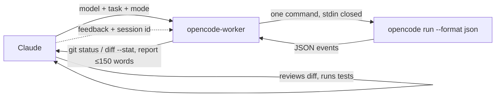

# claude-opencode-delegate

A Claude Code plugin that delegates scoped tasks to any model available in your [OpenCode](https://opencode.ai) install (Grok, Kimi, GLM, Qwen, DeepSeek, MiMo, MiniMax, …). Claude stays the orchestrator: it hands over the task, then reviews the diff and runs the tests.

```text
you    ▸ /opencode grok 4.7 -- add input validation to the signup form
claude ▸ spawns opencode-worker (model: grok 4.7, mode: write)
worker ▸ opencode run … → session ses_abc, 3 files changed, report
claude ▸ reads git diff, runs tests, reports which model did what and a verdict
```

## What ships

| Surface | File                                | Role                                                                                               |
| ------- | ----------------------------------- | -------------------------------------------------------------------------------------------------- |
| Skill   | `skills/opencode-delegate/SKILL.md` | Model picking, brief template, review-after-return rules                                           |
| Agent   | `agents/opencode-worker.md`         | Thin forwarder (`tools: Bash`, `model: haiku`): one `opencode run`                                 |
| Command | `commands/opencode.md`              | `/opencode <model> -- <task>`: splits on `--`, spawns `opencode-worker`                            |
| Hook    | `scripts/route-to-opencode.sh`      | PreToolUse hook (`plugin-hooks/hooks.json`): reroutes built-in subagent calls to `opencode-worker` |

No MCP server, no build step, no `dist/`. Claude Desktop is not supported.

## How it works



The worker resolves the model, builds the prompt, runs a single command, checks `git status --short` and `git diff --stat`, and reports the model, session id, exit status, changed files and OpenCode's own report. It never reviews, fixes or retries; iteration means Claude invokes it again with the session id.

```bash
${OPENCODE_BIN:-opencode} run --format json --agent build --auto [-m provider/model[#variant]] [--session <id>] --title "<title>" -- "<prompt>" </dev/null
```

The run uses your existing OpenCode auth, config, agents and permission rules.

## Automatic routing

A plugin PreToolUse hook (`scripts/route-to-opencode.sh`, wired by `plugin-hooks/hooks.json`) rewrites `Agent`/`Task` calls to Claude Code's built-in subagents into a call to `opencode-delegate:opencode-worker` on Haiku. The `description` and any other input keys are kept; the worker runs the task through `opencode run` using OpenCode's configured default model. The prompt is kept as is for `general-purpose` and untyped calls. `Explore`, `Plan` and `claude-code-guide` calls get a `Read-only task (routed from the ... subagent).` prefix, which forces the worker into read-only mode. `statusline-setup` gets a `Routed from the ... subagent.` note; `claude` is kept as is. Only these built-ins are routed: custom, project, user and plugin agents (reviewers and SDD agents included, and `opencode-worker` itself) are never routed and stay on Claude.

The hook never blocks. It passes the call through unchanged when:

- The subagent is not a built-in one (custom, project, user or plugin agent, including reviewers and SDD agents).
- `OPENCODE_DELEGATE_ROUTE` is `0`, `false`, `no` or `off` (global opt-out; unset or empty means routing is on).
- `OPENCODE_BIN` (default `opencode`) cannot be found, so Claude keeps the original subagent.
- The prompt contains the literal `[no-opencode]` (per-task opt-out).
- `jq` is missing, or the hook input is not valid JSON.

Because the hook is shipped in `plugin-hooks/`, not `hooks/` (which holds this repo's git hooks), it takes effect after the plugin is installed or refreshed.

## Requirements

- [OpenCode](https://opencode.ai) v2+ with at least one provider configured (`opencode models` lists something). Behaviour documented here was verified on 2.1.2.
- `jq` on `PATH` (the worker parses the JSON event stream with it).
- `git` (changed-file detection).

## Install

```text
/plugin marketplace add lehcode/claude-opencode-delegate
/plugin install opencode-delegate@claude-opencode-delegate
```

To use a local clone, add it as a directory marketplace: `/plugin marketplace add /path/to/clone`. After pulling changes, refresh the plugin (`/plugin` → update, or reinstall).

## Usage

Three entry points, all ending in the same `opencode-worker`:

- **Natural language:** "Use kimi k3 via opencode to add tests for `src/date.ts`."
- **Slash command:** `/opencode deepseek v4 flash -- write unit tests for src/date.ts`
- **Agent:** spawn `opencode-worker` from a subagent or workflow with the model and task in its prompt.

### Modes

| Mode            | When                                      | OpenCode flags               |
| --------------- | ----------------------------------------- | ---------------------------- |
| write (default) | Implement, fix, refactor                  | `--agent build --auto`       |
| read-only       | Review, question, summary, second opinion | `--agent plan` (no `--auto`) |

- Write mode passes `--agent build` because OpenCode's `default_agent` is commonly `plan`.
- `--auto` approves permissions not explicitly denied; rules set to `deny` are still enforced.
- Without `--auto`, a headless run auto-rejects permission requests and continues, which is what makes `plan` safe for read-only work.
- `</dev/null` is mandatory: with an open stdin pipe, `opencode run` waits forever and never creates a session.

### Models

| Input                    | Behaviour                                                                                                        |
| ------------------------ | ---------------------------------------------------------------------------------------------------------------- |
| none                     | `-m` omitted; OpenCode uses its configured default model (e.g. `"model"` in `~/.config/opencode/opencode.jsonc`) |
| exact `provider/model`   | Used as is                                                                                                       |
| loose name (`grok 4.7`)  | Resolved against `opencode models`; a named version must match exactly (4.7 never becomes 4.6)                   |
| ambiguous loose name     | Candidate list returned to Claude instead of a guess                                                             |
| `provider/model#variant` | Variant preserved, e.g. `xai/grok-4.7#high`                                                                      |

There are no built-in default models.

### Continuing a session

The worker reports a session id. To give feedback, or to continue after a timeout, invoke `opencode-worker` again with that session id and precise feedback. A run is expected to finish within about 10 minutes (Bash tool timeout maximum is 600000 ms).

### Parallel work

Spawn one `opencode-worker` per model or subtask. Writers share the working directory, so parallel edits need separate git worktrees (`git worktree add`) or non-overlapping files. To compare models, give the same task to each in its own worktree, then diff the results.

## Context restore (optional)

The worker prefixes the task with a short preamble asking OpenCode to restore context itself from engram (`mem_context`, `mem_search`), Graphiti memory and `codegraph_explore`, to stay in scope, not to commit unless told to, and to end with a short report. This works only if those MCP servers are configured in your OpenCode, and it is advisory: models do not always follow it. Without them the preamble is harmless and the task brief should carry the needed context.

## Configuration

| Variable                  | Default    | Description                                                                          |
| ------------------------- | ---------- | ------------------------------------------------------------------------------------ |
| `OPENCODE_BIN`            | `opencode` | Path to the `opencode` executable used by the worker and checked by the routing hook |
| `OPENCODE_DELEGATE_ROUTE` | on         | Set to `0`, `false`, `no` or `off` to disable automatic routing (read by the hook)   |

These are the only variables the plugin honors.

## Development

```bash
bun install
bun run verify                     # typecheck + test + lint + format
bun test test/models.test.ts       # one file
bun test -t "<name>"               # filter by test name
git config core.hooksPath hooks/   # pre-commit (staged lint/format), pre-push (verify)
```

`.prettierignore` excludes local `.atl/`, `openspec/` and `odd/`. Tests are fixture-based and need no running services.

### Library (`src/`)

`src/` is a TypeScript library (`delegate`, `resolveModel`, `buildArgs`, `EventCollector`) left from the removed MCP server. No plugin surface imports it; only the tests exercise it, and it is the reference for how `opencode run` is invoked and its JSON stream parsed. Changing it does not change plugin behaviour. Its provider preference (direct provider over an aggregator, `OPENCODE_DELEGATE_PREFERRED_PROVIDERS` first) applies only here, not to the worker. Variables read by `src/config.ts`:

| Variable                                | Default             | Description                                                       |
| --------------------------------------- | ------------------- | ----------------------------------------------------------------- |
| `OPENCODE_BIN`                          | auto-detected       | Path to `opencode`                                                |
| `OPENCODE_DELEGATE_DEFAULT_MODEL`       | see `src/config.ts` | Model when none given; empty string means OpenCode's own default  |
| `OPENCODE_DELEGATE_READ_MODEL`          | see `src/config.ts` | Model when none given and `auto` is false; empty string as above  |
| `OPENCODE_DELEGATE_AUTO`                | `true`              | Default for `auto`; `0`, `false`, `no`, `off` disable it          |
| `OPENCODE_DELEGATE_TIMEOUT`             | `1800`              | Seconds before a run is killed                                    |
| `OPENCODE_DELEGATE_MAX_OUTPUT`          | `40000`             | Maximum response characters returned                              |
| `OPENCODE_DELEGATE_THINKING`            | `true`              | Include reasoning blocks in output                                |
| `OPENCODE_DELEGATE_CWD`                 | process cwd         | Base working directory                                            |
| `OPENCODE_DELEGATE_PREFERRED_PROVIDERS` | none                | Comma-separated provider order when a model has several providers |

## License

MIT. Originally created by [aashahin](https://github.com/aashahin).
